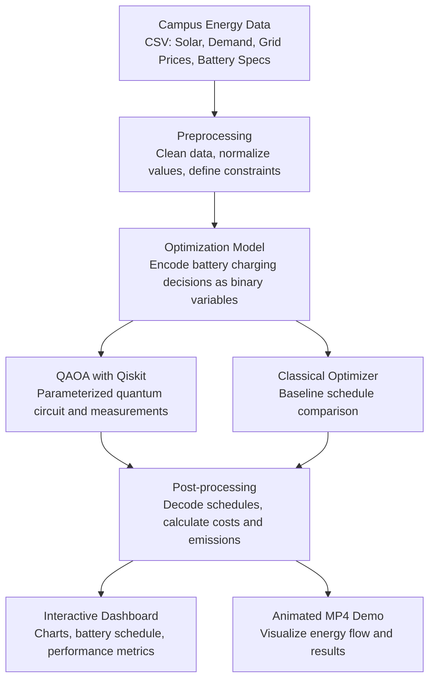

<div align="center">

# Q-Rious Minds

**VTU-QFF-HC-0103** &nbsp;|&nbsp; Tier: **Offline**

</div>

---

<div align="center">

| | |
| :--- | :--- |
| **Team** | Q-Rious Minds |
| **Team ID** | VTU-QFF-HC-0103 |
| **Tier** | Offline |
| **Repository** | [vtu-hc-q-rious-minds](https://github.com/vtu-qiskit-fall-fest-2026/vtu-hc-q-rious-minds.git) |
| **Organisation** | [vtu-qiskit-fall-fest-2026](https://github.com/vtu-qiskit-fall-fest-2026) |
| **Event** | VTU-QFF Hackathon — VTU-Qiskit Fall Fest 2026 |

</div>

---

## 📌 Table of Contents

- [Team Members](#-team-members-github-ids)
- [Problem Statement](#-problem-statement)
- [Proposed Solution](#-proposed-solution)
- [Approach & Architecture](#-approach--architecture)
- [Tech Stack](#-tech-stack)
- [Project Structure](#-project-structure)
- [How to Run](#-how-to-run)
- [How to Push Code](#-how-to-push-code)
- [Submission Checklist](#-submission-checklist)
- [Resources](#-resources)
- [License](#-license)

---

## 👥 Team Members (GitHub IDs)

> Members are added to this repository as **collaborators** and must accept the
> GitHub invitation before they can push. Add your GitHub username below.

| # | Name | GitHub Username | Role |
| :-- | :--- | :--- | :--- |
| 1 | Sahana UP |sahanaup13  | _Team Lead_ |
| 2 | Thrisha SP | thrishaspatil9-hash | _Developer_ |

<!--
Optional: add a plain list instead of the table above.
- @username1
- @username2
-->

---

## ❓ Problem Statement

<!--
State the problem you are solving. Be specific: what is broken or missing,
who experiences it, and why does it matter. Link to the official problem
statement from the brief if one applies.
-->

**Problem:** University campuses often waste excess solar energy and rely on expensive grid electricity because battery charging and discharging schedules are not optimized according to hourly solar generation, campus demand, and electricity prices.
The challenge is to develop a quantum-assisted optimization system using QAOA to determine the most cost-effective battery schedule while meeting campus electricity demand and reducing grid dependence and carbon emissions.


**Why it matters:**
Impact:CarbonWise can help university campuses reduce electricity costs, minimize solar energy waste, decrease dependence on grid electricity, and lower carbon emissions through intelligent battery scheduling.

Opportunity: The solution can be extended to colleges, industries, EV charging stations, and smart cities, demonstrating the potential of quantum-assisted optimization for sustainable energy management.


**Track / Category:** _Online / Offline · Track 6 < Quantum Applications for Climate Change & Sustainability >

---

## 💡 Proposed Solution
CarbonWise is a quantum-assisted energy management platform that optimizes battery charging and discharging schedules for campus microgrids using solar generation, electricity demand, and grid prices. 
Users enter or upload energy data, and the system applies the **Quantum Approximate Optimization Algorithm (QAOA) using Qiskit**, with a classical optimizer as a baseline, to identify cost-effective energy schedules.
An interactive dashboard and animated video visualize the recommended schedule, grid usage, estimated electricity costs, and carbon emissions, helping campuses make more sustainable energy decisions.


**Solution:** 
CarbonWise is a quantum-assisted energy management prototype that optimizes solar energy utilization and battery charging schedules for campus microgrids using QAOA with Qiskit. 
It compares quantum-assisted and classical optimization approaches and visualizes energy generation, battery status, grid consumption, and estimated cost and carbon emissions through an interactive dashboard and animated demonstration video.


**Key idea:** 
Formulates campus solar–battery scheduling as a combinatorial optimization problem, applies QAOA using Qiskit, and benchmarks its results against a classical optimizer to evaluate energy cost, grid dependence, and estimated carbon emissions.

**Why this works:** 
CarbonWise analyzes hourly solar generation, campus electricity demand, battery constraints, and grid prices to identify cost-effective charging and discharging schedules. 
QAOA explores candidate schedules, while a classical optimizer provides a benchmark; comparing electricity costs, solar utilization, grid consumption, and estimated CO₂ emissions helps quantify whether the proposed schedule improves campus energy efficiency.


---

## 🧩 Approach & Architecture



**1. Input:** Hourly solar generation (kW), campus electricity demand (kW), grid electricity prices (₹/kWh), and battery capacity and charging limits, supplied as CSV data.

**2. Preprocessing:** Validate missing values, align hourly measurements, and define battery capacity, state-of-charge limits, charging/discharging limits, and energy-balance constraints.

**3. Quantum Core:** Formulate battery scheduling as a binary optimization problem and use Qiskit's Quantum Approximate Optimization Algorithm (QAOA) with a parameterized quantum circuit to search for candidate schedules.

**4. Post-processing:** Decode measurement outcomes into candidate schedules, check feasibility, and calculate electricity costs, grid consumption, solar utilization, and estimated CO₂ emissions. Compare the results against a classical optimization baseline.

**5. Output:** A web dashboard displaying the recommended battery schedule, comparative performance metrics, animated energy-flow charts, and a downloadable MP4 demonstration video.

---

## 🛠️ Tech Stack

| Layer | Technology |
| :--- | :--- |
| Language | Python 3.11+ |
| Quantum SDK | Qiskit `>=1.0`, Qiskit Aer, Qiskit Runtime |
| Optimisation | Qiskit Optimization / COBYLA / SPSA |
| Simulation | AerSimulator (statevector / noisemodel) |
| Environment | JupyterLab / VS Code, `venv` |
| Version control | Git + GitHub |

---

## 📁 Project Structure

```text
vtu-hc-q-rious-minds/
├── README.md              # This file
├── requirements.txt       # Python dependencies
├── pyproject.toml         # Project metadata (optional)
├── .gitignore
├── notebooks/             # Jupyter notebooks for experiments
│   └── exploration.ipynb
├── src/
│   ├── __init__.py
│   ├── circuit.py         # Quantum circuit construction
│   ├── optimizer.py       # Optimization loop
│   └── main.py            # Entry point
├── data/                  # Datasets (use Git LFS for large files)
├── tests/                 # Unit tests
│   └── test_circuit.py
└── docs/                  # Notes, diagrams, reports
```

---

## 🚀 How to Run

### Prerequisites

- Python 3.11 or newer
- [Git](https://git-scm.com/downloads)
- A GitHub account (you need collaborator access to this repo)

### 1. Clone the repository

```bash
git clone https://github.com/vtu-qiskit-fall-fest-2026/vtu-hc-q-rious-minds.git
cd vtu-hc-q-rious-minds
```

### 2. Create a virtual environment

```bash
python3 -m venv .venv
source .venv/bin/activate        # Linux / macOS
# .venv\Scripts\activate         # Windows (PowerShell)
```

### 3. Install dependencies

```bash
pip install --upgrade pip
pip install -r requirements.txt
```

### 4. Run

```bash
python -m src.main
```

Or launch the notebook workflow:

```bash
jupyter lab
```

### 5. Run the tests

```bash
pytest -q
```

---

## 🔁 How to Push Code

> Full walkthrough: **[Git & Collaboration Handbook](../vtu-hc-guide-git-and-collaboration)** — collaboration
> workflow, branches, pull requests, reviews and conflict resolution.

### Configure Git (first time only)

```bash
git config --global user.name  "Your Name"
git config --global user.email "you@example.com"
```

### Everyday workflow

```bash
# 1. Get the latest changes
git checkout main
git pull origin main

# 2. Create a branch for your work
git checkout -b feature/my-task

# 3. Commit your work
git add .
git commit -m "feat: add variational circuit for the search problem"

# 4. Push the branch
git push -u origin feature/my-task

# 5. Open a Pull Request on GitHub and request a review
#    https://github.com/vtu-qiskit-fall-fest-2026/vtu-hc-q-rious-minds/compare/main...feature/my-task

# 6. After approval, merge into main
git checkout main
git pull origin main
git branch -d feature/my-task
```

### Commit message convention

| Prefix | Meaning |
| :--- | :--- |
| `feat:` | New feature |
| `fix:` | Bug fix |
| `docs:` | Documentation only |
| `test:` | Adding or fixing tests |
| `refactor:` | Code restructure, no behaviour change |
| `chore:` | Build/config/dependency changes |

### Useful commands

```bash
git status              # what changed
git log --oneline -10   # recent commits
git diff                # review changes before committing
git stash               # shelve changes temporarily
git pull --rebase       # update your branch on top of main
```

### Collaborating on the same repo

- **Never push directly to `main`** — open a Pull Request.
- **Pull before you push** to avoid rejected commits.
- **Commit often** with clear messages.
- **Resolve conflicts** locally: `git pull --rebase`, fix the files, then `git add` + `git rebase --continue`.
- **Ask for a review** before merging — a second pair of eyes catches bugs fast.

---

## ✅ Submission Checklist

- [ ] Repository created and **public**
- [ ] All team members added as **collaborators** and invitations accepted
- [ ] `README.md` updated with project details, problem statement and solution
- [ ] Team members listed under [Team Members](#-team-members-github-ids)
- [ ] `requirements.txt` committed and project runs from a clean clone
- [ ] Code pushed to `main` and the latest `main` builds successfully
- [ ] Notebooks committed with **cleared outputs** (or use `nbstrip`)
- [ ] `README` includes a demo screenshot / video link
- [ ] Short project summary submitted on the hackathon portal

---

## 📚 Resources

| Resource | Link |
| :--- | :--- |
| 🔁 Git & collaboration handbook | [Git & Collaboration Handbook](../vtu-hc-guide-git-and-collaboration) |
| ❓ Problem statements, solutions & terms | [Problem Statements, Solutions & Terms](../vtu-hc-guide-problem-and-solution) |
| 📄 README writing guide | [README Guide & Template](../vtu-hc-guide-readme-template) |
| ⚛️ Qiskit documentation | https://docs.quantum.ibm.com/ |
| ⚛️ Qiskit Runtime & primitives | https://quantum.cloud.ibm.com/docs/ |
| 🧪 Qiskit Aer simulator | https://docs.quantum.ibm.com/guides/simulator |
| 💻 IBM Quantum Platform | https://quantum.cloud.ibm.com/ |
| 🎓 Qiskit textbook | https://qiskit.qotlabs.org/learning/ |
| 📋 GitHub Docs | https://docs.github.com/ |

---

## 📄 License

Released under the [MIT License](LICENSE). See `LICENSE` for details.

---

<div align="center">

**Q-Rious Minds** · Team ID `VTU-QFF-HC-0103` · Tier `Offline`
· Built with ⚛️ Qiskit for the VTU-QFF Hackathon

[⬆ Back to Top](#q-rious-minds)

</div>
CARBONWISE — CINEMATIC CAMPUS ENERGY VIDEO + QAOA DEMO

This project creates a cinematic 37-second MP4 with AI-generated drone-style campus visuals, animated solar-to-campus energy flow, surplus energy entering a battery, simulated battery state of charge, evening discharge, a baseline-vs-candidate grid-import chart, and the small Qiskit QAOA optimization result when the optimizer runs successfully.

RUN IT
1. Extract the ZIP to a new folder.
2. In VS Code choose File > Open Folder and select this extracted project folder.
3. Open Terminal > New Terminal.
4. Install requirements: python -m pip install -r requirements.txt
5. Start Flask: python app.py
6. Open http://127.0.0.1:5000 in Chrome.
7. Click “Generate Cinematic Demo Video”. Wait for the MP4 to finish, then press Play in the webpage video player. Use Download MP4 to save it.

WHAT THE VIDEO SHOWS
1. Aerial/drone-style campus concept scene and the energy-management problem.
2. Solar PV generating electricity during daylight.
3. Surplus solar directed into storage after immediate campus needs.
4. Battery state of charge shown from the illustrative input data.
5. Stored energy supporting campus demand when solar output falls.
6. Baseline vs candidate grid-import comparison.
7. QAOA candidate schedule vs exact classical benchmark (if QAOA runs successfully).
8. Closing summary of what CarbonWise measures: cost, grid imports, solar use and estimated CO2.

IMPORTANT LIMITATIONS
- Campus visuals are AI-generated concept visuals, not verified drone footage of VTU infrastructure.
- Energy data are simulated, not live VTU meter readings.
- The optimizer is a small four-decision QAOA research demo using a local statevector simulator, not quantum hardware or a full-campus controller.
- A matched result on this tiny instance is not evidence of quantum advantage.
- Cost/emissions comparisons depend on the input data and the stated assumptions; do not claim a specific percentage reduction unless your computed results support it.

